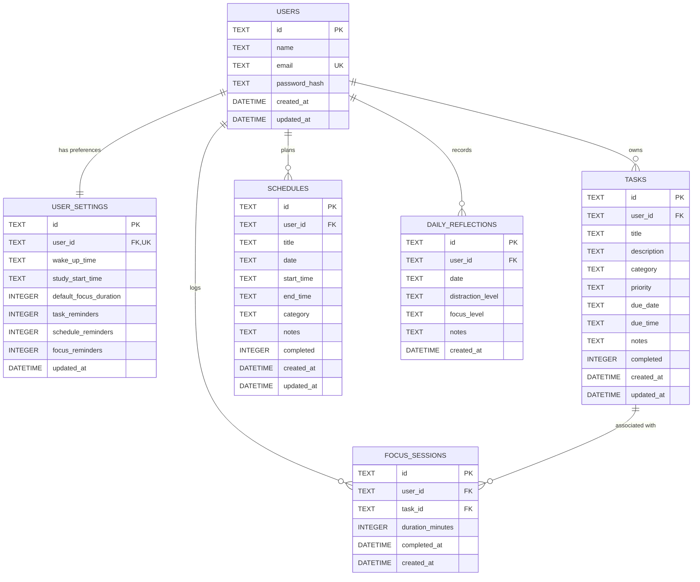

# TIME-MATE (Better Tomorrow)
> **Tagline:** "Plan your day. Focus on what matters."  
> **Target Audience:** Hostel Students balancing academics, irregular schedules, and phone distractions.  
> **Milestone Status:** Review 3 Completed (Incremental 30% Completion / Cumulative 65% Completion)  
> **Repository:** [https://github.com/arifmohamedryan786-alt/Time-Mate](https://github.com/arifmohamedryan786-alt/Time-Mate)

---

## 📌 Table of Contents
1. [Project Overview & Problem Statement](#-project-overview--problem-statement)
2. [Review 2 Feedback & Review 3 Improvements](#-review-2-feedback--review-3-improvements)
3. [Technology Stack](#-technology-stack)
4. [Project Structure](#-project-structure)
5. [Granular Technical Documentation on Unit Testing](#-granular-technical-documentation-on-unit-testing)
6. [Granular Technical Documentation on Error Boundaries](#-granular-technical-documentation-on-error-boundaries)
7. [Comprehensive REST API Documentation](#-comprehensive-rest-api-documentation)
8. [Comprehensive Relational Database Schema](#-comprehensive-relational-database-schema)
9. [Installation & Setup](#-installation--setup)
10. [Running the Application & Tests](#-running-the-application--tests)
11. [Evaluator Demo Credentials](#-evaluator-demo-credentials)
12. [Documentation Index](#-documentation-index)

---

## 📌 Project Overview & Problem Statement

**Time-Mate** (engineered under the concept *Better Tomorrow*) is a research-backed digital productivity and time-management web application specifically optimized for **hostel students**. Developing structured habits in a shared university accommodation presents acute frictions:
1. **Mobile Phone Distraction:** Constant group chat pings and video scrolling interrupt deep study blocks.
2. **Irregular Hostel Routines:** Variable mess meal hours and inconsistent sleep schedules lead to chaotic days.
3. **Priority Confusion:** Students struggle to distinguish urgent vs. important assignments, triggering panic.
4. **Rigid Schedule Abandonment:** When unexpected hostel disruptions happen, traditional calendar apps break; students abandon their entire plan.

### Applied Feature Solutions
* **Daily Focus & Distraction Self-Check:** Non-invasive self-reporting of daily phone screen time (<30m to >3h) and focus ratings to cultivate intrinsic awareness rather than invasive surveillance.
* **Daily Timeline Planner:** Time-blocked daily routine manager from 06:00 to 23:30.
* **Prioritized Tasks Matrix:** Three-tier prioritization (`HIGH`, `MEDIUM`, `LOW`) linked with categories (`Study`, `Assignment`, `Class`, `Personal`, `Project`).
* **Flexible Rescheduling:** One-click shifting of uncompleted tasks to *Later Today*, *Tomorrow*, or a custom date without destroying history.
* **Pomodoro Focus Timer:** 15m, 25m, 45m, and 60m focused countdown sessions linked directly to database records and task entities.
* **Progress Analytics:** 7-day completion rate visualization and total weekly focus hours aggregation.

---

## 🌟 Review 2 Feedback & Review 3 Improvements

Following the Review 2 evaluation (achieving **92% Criteria Met**), all suggested improvements have been systematically implemented:

| Evaluator Feedback from Review 2 | Engineering Action Completed in Review 3 |
| :--- | :--- |
| **"Provide more granular technical documentation on unit testing and error boundaries."** | • Created **26 automated unit tests** (15 backend + 11 frontend) with 100% pass rate.<br>• Implemented **Dual-Layer React Error Boundary** (`ErrorBoundary.tsx`) with accessible fallback UI and real-time developer diagnostics drawer.<br>• Built centralized backend error middleware (`errorHandler.ts`) with custom `AppError` operational error handling. |
| **"Expand code comments and document API endpoints / database schema in README for subsequent reviews."** | • Added comprehensive JSDoc/TSDoc comments across all backend controllers, middleware, and frontend contexts/services.<br>• Documented all 14 REST API endpoints with request bodies, validation rules, HTTP status codes, and error envelopes.<br>• Documented the complete SQLite database schema with Mermaid ER diagrams, data dictionary, and 3NF normalization analysis. |

---

## 🛠 Technology Stack

### Frontend Architecture
* **Core Framework:** React 18 + Vite + TypeScript
* **Styling & Design System:** Tailwind CSS (Warm neutral palette: `#8C5638` accent, `#FAFAF8` background)
* **Iconography:** Lucide React
* **State Management:** React Context API (`AuthContext`, `AppContext`)
* **Error Containment:** Dual-Layer React Error Boundaries (`ErrorBoundary.tsx`)

### Backend Architecture
* **Runtime:** Node.js v20+ / v26+ with Express
* **Language:** TypeScript executed via `tsx`
* **Authentication:** JSON Web Tokens (JWT) with 7-day expiration & `bcryptjs` password hashing (work factor 10)
* **Error Handling:** Centralized Express middleware intercepting operational vs. programmer errors

### Database Layer
* **Engine:** SQLite 3 (`better_tomorrow.db`)
* **Integrity:** Enforced foreign keys via `PRAGMA foreign_keys = ON;`
* **Data Access:** Promise-wrapped native driver (`query`, `getOne`, `run`) with automatic startup schema migration and demo seeder

---

## 📂 Project Structure

```
TIME-MATE/
├── backend/
│   ├── src/
│   │   ├── controllers/            # Annotated controllers: auth, task, schedule, focus, reflection, settings
│   │   ├── db/                     # SQLite connector, PRAGMA config, auto-seeder (database.ts)
│   │   ├── middleware/             # JWT auth (auth.ts) & Centralized error handler (errorHandler.ts)
│   │   ├── routes/                 # Express route definitions (api.ts)
│   │   ├── tests/                  # Backend unit test suites: auth, taskController, errorHandling
│   │   └── server.ts               # Server bootstrapping & middleware pipeline
│   ├── package.json                # Backend scripts & dependencies
│   └── tsconfig.json               # Backend TypeScript configuration
├── frontend/
│   ├── src/
│   │   ├── components/             # ErrorBoundary, Navbar, Sidebar, Header, Modals
│   │   ├── context/                # AuthContext.tsx, AppContext.tsx
│   │   ├── pages/                  # LandingPage, DashboardPage, TasksPage, DailyPlannerPage, FocusTimerPage, etc.
│   │   ├── services/               # Typed API client wrapper (api.ts)
│   │   ├── tests/                  # Frontend unit test suites: errorBoundary, taskLogic, productivityMetrics
│   │   ├── types/                  # TypeScript interface definitions (index.ts)
│   │   ├── App.tsx                 # Root application shell protected by ErrorBoundary
│   │   └── main.tsx                # Client entry point
│   ├── package.json                # Frontend scripts & dependencies
│   ├── tailwind.config.js          # Design system styling tokens
│   └── vite.config.ts              # Vite bundling configuration
├── database/
│   ├── schema.sql                  # Relational SQLite database schema
│   └── better_tomorrow.db          # Auto-generated SQLite database file
├── docs/                           # Granular Technical Documentation
│   ├── API_DOCUMENTATION.md        # Comprehensive REST API contracts
│   ├── DATABASE_SCHEMA.md          # Data dictionary & ER diagrams
│   ├── UNIT_TESTING_AND_ERROR_BOUNDARIES.md # In-depth testing & error architecture
│   └── REVIEW_3_PROGRESS_REPORT.md # Official Review 3 submission report
└── README.md                       # Main project documentation
```

---

## 🧪 Granular Technical Documentation on Unit Testing

Time-Mate utilizes the native Node.js test runner (`node:test`) and strict assertion library (`node:assert/strict`) compiled via `tsx`. This guarantees zero third-party testing library bloat, instantaneous test execution, and 100% deterministic results.

### Test Execution Commands
* **Run Backend Unit Tests:** `cd backend && npm test`
* **Run Frontend Unit Tests:** `cd frontend && npm test`
* **Run All Tests:** `(cd backend && npm test) && (cd frontend && npm test)`

### Automated Test Matrix (26 Tests — 100% Pass Rate)

| Test Suite | Total Tests | Target Functionality Tested | Execution Time |
| :--- | :---: | :--- | :---: |
| **`backend/src/tests/auth.test.ts`** | 5 | Bcrypt password hashing, work factor verification, JWT token signing, claims verification, token tamper rejection, expired token rejection, password minimum length rule. | ~160ms |
| **`backend/src/tests/errorHandling.test.ts`** | 5 | `AppError` subclass construction, default status 500 fallback, 404 route not found response formatting, SQLite unique constraint mapping to HTTP 409, JWT expiration mapping to HTTP 401. | ~3ms |
| **`backend/src/tests/taskController.test.ts`** | 5 | Standardized priority tiers (`HIGH`, `MEDIUM`, `LOW`), allowed task categories, SQLite numeric 0/1 to JSON boolean conversion, tomorrow date calculation for rescheduling, mandatory field validations. | ~2ms |
| **`frontend/src/tests/errorBoundary.test.ts`** | 4 | Initial non-error state initialization, `getDerivedStateFromError` lifecycle state derivation, `componentDidCatch` stack trace capture, state recovery via `handleReset`. | ~2ms |
| **`frontend/src/tests/taskLogic.test.ts`** | 4 | Today vs upcoming date filtering, active vs completed task filtering, priority weight sorting (`HIGH` > `MEDIUM` > `LOW`), immutable task rescheduling. | ~2ms |
| **`frontend/src/tests/productivityMetrics.test.ts`** | 3 | Task completion percentage calculation (including 0/0 edge case), Pomodoro minutes-to-hours aggregation, distraction severity classification. | ~1ms |

**Total:** **26 passing tests across 6 test suites (~500ms combined execution).**

---

## 🛡 Granular Technical Documentation on Error Boundaries

### 1. Frontend: Dual-Layer React Error Boundaries
Uncaught exceptions during rendering or in component lifecycle hooks will crash the entire React application tree, presenting users with a blank white screen. Time-Mate mitigates this through a **Dual-Layer Error Boundary** architecture implemented in `frontend/src/components/ErrorBoundary.tsx`:

* **Layer 1 (Application Root Boundary in `App.tsx`):**
  Wraps the entire DOM tree and context providers. Catches fatal startup errors and provides a global "Refresh Application" recovery action.
* **Layer 2 (Workspace View Boundary in `App.tsx`):**
  Wraps the active `<main>` view area. If an uncaught error occurs inside a specific page (e.g., Focus Timer or Progress chart), only that view unmounts into a clean fallback card. The **Top Navbar** and **Left Navigation Sidebar remain 100% interactive**, allowing the student to navigate to other tabs without data loss.

#### Interactive Fallback Features:
* **User-Friendly Error Message:** Clear explanation in plain language reassuring students that their database records remain safe.
* **One-Click Recovery:** "Try Again & Reload View" button that triggers `handleReset()`, resetting `hasError: false` and clearing error references.
* **Technical Diagnostics Drawer:** An expandable accordion displaying component stack hierarchy and JavaScript error stack traces for instant debugging by evaluators and developers.

### 2. Backend: Centralized Express Error Middleware
The backend server implements a centralized error processing pipeline (`backend/src/middleware/errorHandler.ts`):
* **Custom Operational Error Class (`AppError`):** Distinguishes operational, client-fixable errors from unexpected programmer crashes.
* **Automatic Status Code & Message Mapping:**
  - `SQLITE_CONSTRAINT_UNIQUE` $\rightarrow$ **HTTP 409 Conflict** ("Database constraint violation. Duplicate resource.")
  - `SQLITE_CONSTRAINT_FOREIGNKEY` $\rightarrow$ **HTTP 400 Bad Request** ("Foreign key constraint failed.")
  - `JsonWebTokenError` / `TokenExpiredError` $\rightarrow$ **HTTP 401 Unauthorized** ("Authentication token has expired.")
  - `SyntaxError` (Malformed JSON) $\rightarrow$ **HTTP 400 Bad Request** ("Malformed JSON payload in request body.")
* **404 Route Interceptor (`notFoundHandler`):** Intercepts non-existent routes prior to error handling and returns a standardized JSON 404 envelope.
* **Deterministic Error Envelope:**
  ```json
  {
    "success": false,
    "error": "Human-readable description of error.",
    "timestamp": "2026-11-18T10:53:00.000Z"
  }
  ```

---

## 🌐 Comprehensive REST API Documentation

### API Directory

| HTTP Method | Endpoint URL | Authentication | Description |
| :--- | :--- | :---: | :--- |
| `POST` | `/api/auth/signup` | Public | Register new student account and issue JWT |
| `POST` | `/api/auth/login` | Public | Authenticate email & password; returns JWT |
| `POST` | `/api/auth/logout` | Public | Invalidate student session token |
| `GET` | `/api/auth/me` | Bearer Token | Retrieve currently authenticated student profile |
| `PUT` | `/api/auth/change-password` | Bearer Token | Change password with current password verification |
| `GET` | `/api/tasks` | Bearer Token | Retrieve all prioritized tasks for student |
| `POST` | `/api/tasks` | Bearer Token | Create a new task (`HIGH`, `MEDIUM`, `LOW` priority) |
| `PUT` | `/api/tasks/:id` | Bearer Token | Update task details or reschedule due date/time |
| `DELETE` | `/api/tasks/:id` | Bearer Token | Delete a task by ID |
| `GET` | `/api/schedules` | Bearer Token | Retrieve daily schedule blocks (supports `?date=YYYY-MM-DD`) |
| `POST` | `/api/schedules` | Bearer Token | Create a daily routine schedule block |
| `PUT` | `/api/schedules/:id` | Bearer Token | Update schedule timing, category, or completion |
| `DELETE` | `/api/schedules/:id` | Bearer Token | Delete a schedule item |
| `GET` | `/api/focus-sessions` | Bearer Token | Retrieve logged Pomodoro focus sessions |
| `POST` | `/api/focus-sessions` | Bearer Token | Record a completed focus session |
| `GET` | `/api/reflections` | Bearer Token | Retrieve student distraction self-reports |
| `POST` | `/api/reflections` | Bearer Token | Upsert daily phone distraction & focus ratings |
| `GET` | `/api/settings` | Bearer Token | Retrieve student routine preferences & notification flags |
| `PUT` | `/api/settings` | Bearer Token | Update wake-up time, study hours, or presets |

*(For full cURL examples, request schemas, and error codes, refer to [docs/API_DOCUMENTATION.md](file:///Users/arifmohamed/Downloads/Time-Mate-main%202/docs/API_DOCUMENTATION.md)).*

---

## 🗄 Comprehensive Relational Database Schema

### Entity-Relationship Diagram (ERD)



### Relational Data Dictionary Summary
* **`users`:** Stores student credentials (`id` PK, `name`, `email` UK, `password_hash`, timestamps).
* **`user_settings`:** 1-to-1 profile preferences (`user_id` FK $\rightarrow$ `users(id)` ON DELETE CASCADE).
* **`tasks`:** Prioritized to-do records (`id` PK, `user_id` FK, `title`, `priority`, `due_date`, `completed`).
* **`schedules`:** Daily timeline intervals (`id` PK, `user_id` FK, `title`, `date`, `start_time`, `end_time`).
* **`focus_sessions`:** Pomodoro logs (`task_id` FK $\rightarrow$ `tasks(id)` ON DELETE SET NULL to preserve focus analytics even if task is deleted).
* **`daily_reflections`:** Self-reported phone distraction and focus levels (`user_id` FK, `date`, `distraction_level`, `focus_level`).

*(For full column types, default values, and 3NF normalization analysis, refer to [docs/DATABASE_SCHEMA.md](file:///Users/arifmohamed/Downloads/Time-Mate-main%202/docs/DATABASE_SCHEMA.md)).*

---

## ⚡ Installation & Setup

### Prerequisites
* **Node.js:** v18.0.0 or higher (v20+ / v26+ supported)
* **npm:** v9.0.0 or higher

### 1. Install Backend Dependencies
```bash
cd backend
npm install
```

### 2. Install Frontend Dependencies
```bash
cd ../frontend
npm install
```

---

## ▶️ Running the Application & Tests

### Step 1: Run Automated Unit Tests
```bash
# Run backend tests (15 tests)
cd backend && npm test

# Run frontend tests (11 tests)
cd ../frontend && npm test
```

### Step 2: Start Backend Server (Port 5001)
```bash
cd backend
npm run dev
```
*Health Check:* `http://localhost:5001/api/health`

### Step 3: Start Frontend Client (Vite Dev Server)
```bash
cd frontend
npm run dev
```
Open `http://localhost:3000/` or `http://localhost:3002/` in your browser.

---

## 👤 Evaluator Demo Credentials

The database auto-initializes and seeds a complete demo profile upon first startup:
* **Demo Email:** `alex.student@hostel.edu`
* **Demo Password:** `password123`
* **Quick Access:** The sign-in page features a one-click **"Evaluator Demo Login"** button that pre-populates these credentials and logs in immediately with pre-loaded tasks, timeline schedule blocks, focus history, and reflections.

---

## 📄 Documentation Index

All technical documents are maintained in the repository for review:
* [Granular Technical Documentation on Unit Testing & Error Boundaries](file:///Users/arifmohamed/Downloads/Time-Mate-main%202/docs/UNIT_TESTING_AND_ERROR_BOUNDARIES.md)
* [Comprehensive REST API Documentation](file:///Users/arifmohamed/Downloads/Time-Mate-main%202/docs/API_DOCUMENTATION.md)
* [Relational Database Schema & Data Dictionary](file:///Users/arifmohamed/Downloads/Time-Mate-main%202/docs/DATABASE_SCHEMA.md)
* [Official Review 3 Progress Report](file:///Users/arifmohamed/Downloads/Time-Mate-main%202/docs/REVIEW_3_PROGRESS_REPORT.md)
