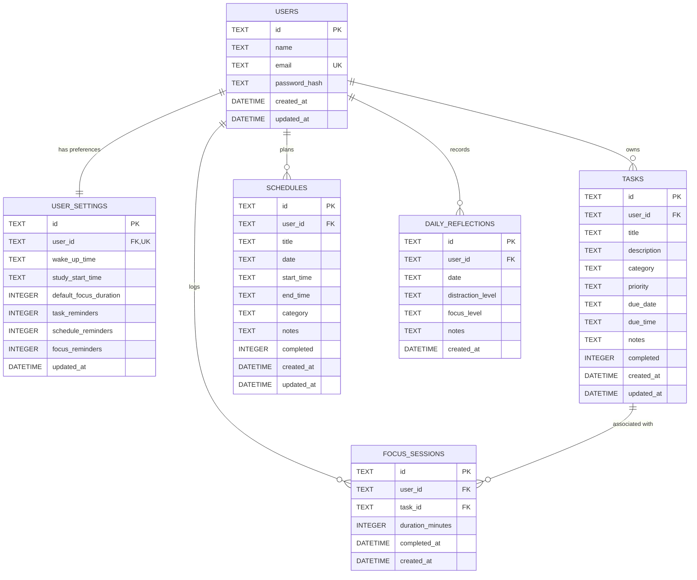

# TIME-MATE: Relational Database Architecture & Schema Specification

This document provides granular technical documentation for the relational database schema underlying **Time-Mate**. The system uses **SQLite 3** with foreign key constraints enabled via `PRAGMA foreign_keys = ON;`.

---

## 1. Entity-Relationship Diagram (ERD)

---

## 2. Table Data Dictionary

### 2.1 Table: `users`
Stores student authentication identity records and credential hashes.

| Column | Data Type | Constraints | Default | Description |
| :--- | :--- | :--- | :--- | :--- |
| `id` | `TEXT` | `PRIMARY KEY` | — | Unique user identifier (e.g., `usr_1731908400000_abc12`) |
| `name` | `TEXT` | `NOT NULL` | — | Full name of the student |
| `email` | `TEXT` | `UNIQUE NOT NULL` | — | Unique student email address (case-insensitive) |
| `password_hash` | `TEXT` | `NOT NULL` | — | Salted bcrypt password hash (work factor 10) |
| `created_at` | `DATETIME` | `DEFAULT CURRENT_TIMESTAMP` | Current UTC | Registration timestamp |
| `updated_at` | `DATETIME` | `DEFAULT CURRENT_TIMESTAMP` | Current UTC | Last profile modification timestamp |

---

### 2.2 Table: `user_settings`
Stores daily routine presets and notification toggles per student.

| Column | Data Type | Constraints | Default | Description |
| :--- | :--- | :--- | :--- | :--- |
| `id` | `TEXT` | `PRIMARY KEY` | — | Setting identifier (`set_<user_id>`) |
| `user_id` | `TEXT` | `UNIQUE NOT NULL`, `FK -> users(id) ON DELETE CASCADE` | — | Reference to owning student |
| `wake_up_time` | `TEXT` | `NOT NULL` | `'07:00'` | Typical morning wake time (`HH:MM`) |
| `study_start_time` | `TEXT` | `NOT NULL` | `'09:00'` | Scheduled start for academic study |
| `default_focus_duration` | `INTEGER` | `NOT NULL` | `25` | Default Pomodoro duration in minutes |
| `task_reminders` | `INTEGER` | `NOT NULL` (Boolean `0`/`1`) | `1` | Enable task reminder notifications |
| `schedule_reminders` | `INTEGER` | `NOT NULL` (Boolean `0`/`1`) | `1` | Enable schedule block notifications |
| `focus_reminders` | `INTEGER` | `NOT NULL` (Boolean `0`/`1`) | `1` | Enable Pomodoro rest/break notifications |
| `updated_at` | `DATETIME` | `DEFAULT CURRENT_TIMESTAMP` | Current UTC | Last settings update timestamp |

---

### 2.3 Table: `tasks`
Stores student to-do items, prioritization tier, category, due dates, and completion status.

| Column | Data Type | Constraints | Default | Description |
| :--- | :--- | :--- | :--- | :--- |
| `id` | `TEXT` | `PRIMARY KEY` | — | Unique task identifier (`tsk_...`) |
| `user_id` | `TEXT` | `NOT NULL`, `FK -> users(id) ON DELETE CASCADE` | — | Student owner |
| `title` | `TEXT` | `NOT NULL` | — | Brief title of assignment or task |
| `description` | `TEXT` | — | `''` | Detailed task instructions or requirements |
| `category` | `TEXT` | — | `'Study'` | Enum: `Study`, `Assignment`, `Class`, `Personal`, `Project`, `Other` |
| `priority` | `TEXT` | — | `'MEDIUM'` | Enum: `HIGH`, `MEDIUM`, `LOW` |
| `due_date` | `TEXT` | `NOT NULL` | — | Due date in ISO format (`YYYY-MM-DD`) |
| `due_time` | `TEXT` | — | `'23:59'` | Deadline time in 24h format (`HH:MM`) |
| `notes` | `TEXT` | — | `''` | Additional student reference notes |
| `completed` | `INTEGER` | `NOT NULL` (Boolean `0`/`1`) | `0` | Completion status flag |
| `created_at` | `DATETIME` | `DEFAULT CURRENT_TIMESTAMP` | Current UTC | Record creation timestamp |
| `updated_at` | `DATETIME` | `DEFAULT CURRENT_TIMESTAMP` | Current UTC | Last status/reschedule timestamp |

---

### 2.4 Table: `schedules`
Stores time-sequenced daily routine blocks for visual timeline planning.

| Column | Data Type | Constraints | Default | Description |
| :--- | :--- | :--- | :--- | :--- |
| `id` | `TEXT` | `PRIMARY KEY` | — | Unique schedule item identifier (`sch_...`) |
| `user_id` | `TEXT` | `NOT NULL`, `FK -> users(id) ON DELETE CASCADE` | — | Student owner |
| `title` | `TEXT` | `NOT NULL` | — | Activity title (e.g. "Hostel Mess Breakfast") |
| `date` | `TEXT` | `NOT NULL` | — | Calendar date (`YYYY-MM-DD`) |
| `start_time` | `TEXT` | `NOT NULL` | — | Block start time (`HH:MM`, 24h) |
| `end_time` | `TEXT` | `NOT NULL` | — | Block end time (`HH:MM`, 24h) |
| `category` | `TEXT` | — | `'Study'` | Enum: `Study`, `Assignment`, `Class`, `Meal`, `Personal`, `Rest`, `Other` |
| `notes` | `TEXT` | — | `''` | Room number, professor name, or notes |
| `completed` | `INTEGER` | `NOT NULL` (Boolean `0`/`1`) | `0` | Timeline item completion flag |
| `created_at` | `DATETIME` | `DEFAULT CURRENT_TIMESTAMP` | Current UTC | Record creation timestamp |
| `updated_at` | `DATETIME` | `DEFAULT CURRENT_TIMESTAMP` | Current UTC | Modification timestamp |

---

### 2.5 Table: `focus_sessions`
Records completed Pomodoro focus intervals linked optionally to tasks.

| Column | Data Type | Constraints | Default | Description |
| :--- | :--- | :--- | :--- | :--- |
| `id` | `TEXT` | `PRIMARY KEY` | — | Unique focus session ID (`foc_...`) |
| `user_id` | `TEXT` | `NOT NULL`, `FK -> users(id) ON DELETE CASCADE` | — | Student owner |
| `task_id` | `TEXT` | `FK -> tasks(id) ON DELETE SET NULL` | `NULL` | Associated task (null if generic study) |
| `duration_minutes` | `INTEGER` | `NOT NULL` | — | Duration completed (15, 25, 45, 60 min) |
| `completed_at` | `DATETIME` | `DEFAULT CURRENT_TIMESTAMP` | Current UTC | Completion timestamp |
| `created_at` | `DATETIME` | `DEFAULT CURRENT_TIMESTAMP` | Current UTC | Record insertion timestamp |

---

### 2.6 Table: `daily_reflections`
Logs daily self-reported mobile distraction time and subjective focus level.

| Column | Data Type | Constraints | Default | Description |
| :--- | :--- | :--- | :--- | :--- |
| `id` | `TEXT` | `PRIMARY KEY` | — | Unique reflection ID (`ref_...`) |
| `user_id` | `TEXT` | `NOT NULL`, `FK -> users(id) ON DELETE CASCADE` | — | Student owner |
| `date` | `TEXT` | `NOT NULL` | — | Reflection date (`YYYY-MM-DD`) |
| `distraction_level` | `TEXT` | `NOT NULL` | — | Enum: `<30 min`, `30–60 min`, `1–2h`, `2–3h`, `>3h` |
| `focus_level` | `TEXT` | `NOT NULL` | — | Enum: `Low`, `Okay`, `Good`, `Excellent` |
| `notes` | `TEXT` | — | `''` | Optional student qualitative thoughts |
| `created_at` | `DATETIME` | `DEFAULT CURRENT_TIMESTAMP` | Current UTC | Entry timestamp |

---

## 3. Relational Integrity & Normalization (3NF)

1. **Third Normal Form (3NF) Compliance:**
   - Every non-key attribute is non-transitively dependent on the primary key.
   - User settings are segregated from identity to prevent redundant updates.
   - Focus sessions link dynamically to tasks via nullable foreign keys with `ON DELETE SET NULL` preserving historical focus minutes even if a completed task is archived.
2. **Cascading Deletions:**
   - Deleting a student user cascades automatically to delete all linked settings, tasks, schedules, focus records, and reflections (`ON DELETE CASCADE`), ensuring zero orphaned database records.
3. **Database Constraints & Engine Enforcement:**
   - Foreign key integrity is explicitly activated upon every connection through `PRAGMA foreign_keys = ON;`.
